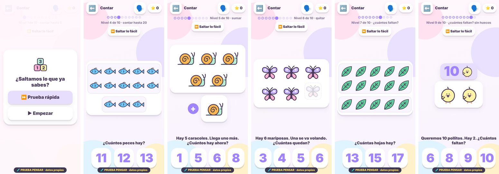
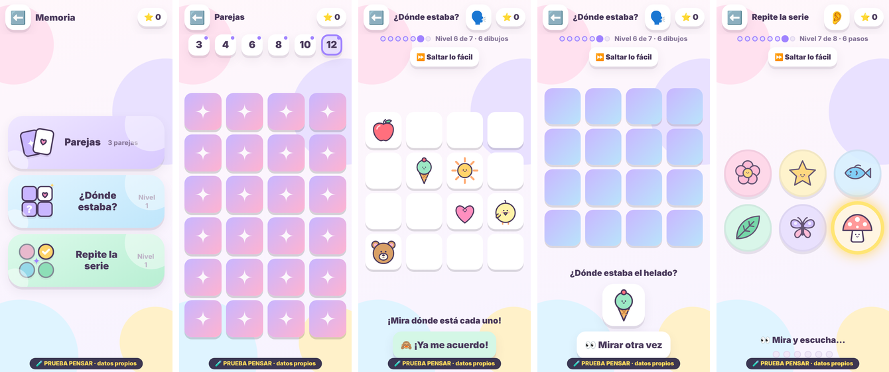
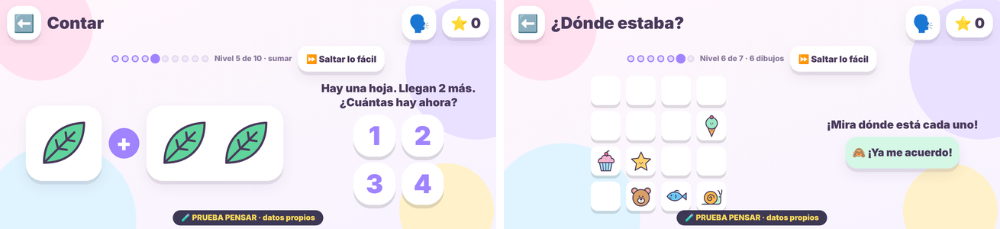
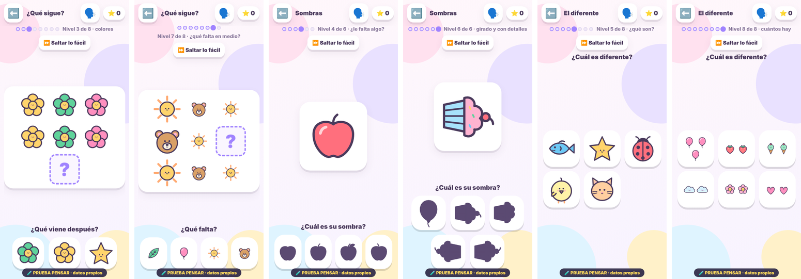
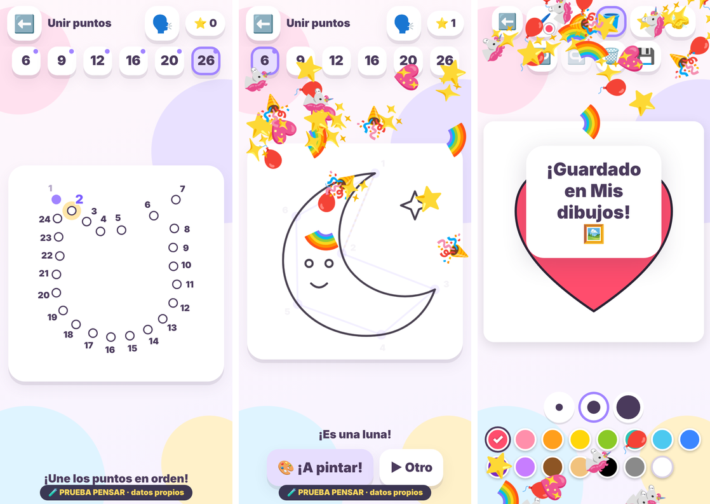
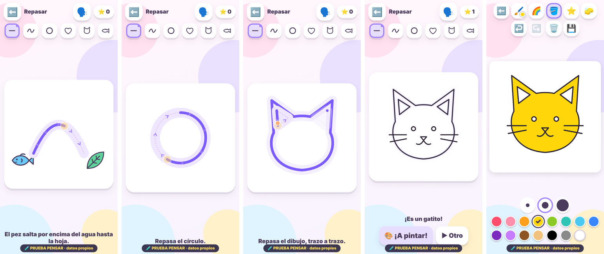

# Juegos de pensar: Contar y Memoria más retadores (04/11/2026)

**Copia aislada. No es el juego de Amaia, no está integrada y no cambia nada del juego ni de `main`.**
Rama `juegos-pensar` (creada desde `avatar-creador` `6a91012`). Datos propios con el prefijo `pen1:`.

Pedido de la propietaria (04/11/2026): «Retomamos los juegos de pensar. A Amaia le gustan todos, pero los resuelve
demasiado rápido. […] Prepara una copia aislada con mejoras en Contar y Memoria […] Muéstrame una primera versión
jugable antes de ampliar al resto. Protege las partidas y el funcionamiento sin conexión. No publiques en main todavía
ni modifiques los archivos en los que esté trabajando el otro chat.»

## Fases y estado

| Fecha | Fase | Estado |
| --- | --- | --- |
| 04/11/2026 | Primera versión jugable de Contar y Memoria en copia aislada (`5390dfc`) | Probada en Chromium (52/52). |
| 04/11/2026, 16:29 | **La propietaria aprueba en general Contar y Memoria tras probarlos en su iPhone** | Aprobación general: **no** se dan por comprobados en el iPhone todos los niveles y casos. |
| 04/11/2026 | **2.ª entrega:** «¿Qué sigue?», «Sombras» y «El diferente» con dificultad progresiva + **«Unir puntos y pintar»** (ver abajo) | Probada en Chromium (35/35 y 9/9 sin conexión); **pendiente de probar en el iPhone**. |
| 05/11/2026 | **Contar y Memoria publicados en `main`** (`021c67e`, versión `5889ab82ca5d`, D-035) | Publicado. Desde el 07/11, **solo el chat de `avatar-creador` reúne y publica**; este chat sigue en `juegos-pensar`. |
| 07/11/2026 | **3.ª entrega: «Repasar dibujos»** (menú Pintar; ver abajo) | Probada en Chromium (28/28; sin conexión 10/10); **pendiente de probar en el iPhone**. La 2.ª entrega (`cf80691`) sigue pendiente de la prueba de la propietaria. |
| Al integrar | Pasar Contar y Memoria al juego (`index.html`, generador de publicación, versión de `sw.js`) | Lo coordina la propietaria. |

## De dónde parte

La copia es el **juego publicado** (`main` `031ce07` = la prueba completa `4d950bc`: muñeca nueva, Pintar, Heladería,
logros, voz natural) con **tres archivos nuevos** cargados al final: `pensar.css`, `dibujos.js` y `pensar.js`.
`preparar_copia.py` reutiliza los pasos de la prueba completa y **comprueba** que el resultado es igual a ella salvo la
carpeta, el título y esos tres archivos. No cambia ningún otro archivo del repositorio.

Hoy, en el juego publicado: **Contar** pide de 1 a 10 objetos (emojis) con 3 respuestas; cada acierto da +1 ⭐ y sube
`lv_contar`, y cada fallo lo baja. **Parejas** tiene 3, 6 u 8 parejas de emojis que se eligen a mano (no se guardan).

## Qué cambia en esta copia

En el menú Pensar, «Parejas» pasa a ser **Memoria** (tres juegos) y **Contar** es nuevo. «¿Qué sigue?», «Sombras» y «El
diferente» siguen como hoy.

### Contar: 10 pasos

| Nivel | Qué se pide | Cómo se ve |
| --- | --- | --- |
| 1 | contar hasta 5 | 3 respuestas |
| 2 | contar hasta 10 | 3 respuestas |
| 3 | contar de 9 a 15 | en filas de 5 y grupos de 10 |
| 4 | contar de 12 a 20 | en filas de 5 y grupos de 10 |
| 5 | **sumar** (hasta 6): «Hay 3 fresas. Llegan 2 más. ¿Cuántas hay ahora?» | dos grupos con un «+»; 4 respuestas |
| 6 | **quitar** (hasta 6): «Hay 6 globos. 2 se van volando. ¿Cuántos quedan?» | los que se van se aclaran |
| 7 | **¿cuántos faltan?** (hasta 10): «Queremos 7 estrellas. Hay 4.» | huecos vacíos para los que faltan |
| 8 | sumar y quitar hasta 10 | |
| 9 | ¿cuántos faltan? sin huecos | el número que queremos, en grande |
| 10 | todo mezclado hasta 20 | |

- **Variedad:** 20 dibujos, colocación en filas o «suelta», respuestas cercanas (por ejemplo, 6, 7, 8 y 10, o el número de
  uno de los grupos) para que no se acierte por tamaño. Desde el nivel 3, uno de cada cuatro ejercicios aproximadamente es
  un **repaso** de un nivel anterior (no cuenta para subir ni bajar).
- Se sigue pudiendo **tocar cada dibujo para contarlo** (como hoy) y 🗣️ repite la pregunta.

### Memoria: tres juegos

- **Parejas:** de **3 a 12 parejas** (3, 4, 6, 8, 10 y 12), con botones para elegir el tamaño, como hoy. Al terminar dos
  tableros bien resueltos se pasa al siguiente tamaño.
- **¿Dónde estaba?** (recordar posiciones): se ven unos dibujos en un tablero; cuando quiere, toca **«🙈 ¡Ya me acuerdo!»**,
  se tapan y se le pregunta «¿Dónde estaba el pollito?». 7 niveles: de 2 dibujos en 2 × 2 a 8 dibujos en 4 × 4, con
  1 a 3 preguntas por ronda.
- **Repite la serie** (secuencias): unos botones con dibujos se iluminan y suenan en orden; luego los repite. 8 niveles:
  de 3 botones y 2 pasos a 6 botones y 7 pasos. 👂 la enseña otra vez.

### Reglas comunes

- **Sin cronómetro:** nada se acaba por tiempo y **la rapidez no cuenta** para nada. En «¿Dónde estaba?» los dibujos se
  ven hasta que ella decide taparlos; en «Repite la serie» la demostración va siempre al mismo ritmo.
- **Sube tras varios aciertos:** un ejercicio cuenta como bien hecho si sale a la primera o con un solo fallo, sin pista.
  Contar, «¿Dónde estaba?» y la serie suben tras **3** bien hechos seguidos en ese nivel; las parejas, tras **2** tableros.
- **Pistas cuando se atasca:**
  - Contar: al primer fallo, «¡Casi!» con una ayuda («Cuenta todos juntos», «Cuenta solo los que quedan», «Cuenta los
    huecos vacíos»…) y esa respuesta se aparta. Al segundo, se cuentan uno a uno en voz alta y brilla la buena.
  - Parejas: tras 3 fallos seguidos, asoma una pareja un momento.
  - «¿Dónde estaba?»: se ve qué había en la casilla tocada; al segundo fallo brilla la buena. «👀 Mirar otra vez» vuelve
    a enseñarlo todo.
  - Serie: al fallar se enseña otra vez; al segundo fallo brilla el siguiente botón.
- **Si se atasca 3 veces seguidas** en un nivel, sigue en el nivel anterior, sin avisos. Lo alcanzado (los puntos de
  arriba) no se pierde.
- **Sin castigos ni pérdida de premios:** los fallos no quitan estrellas ni logros.
- **Estrellas como hoy, sin premios nuevos por respuesta:**
  - Contar: +1 ⭐ por acierto, igual que ahora.
  - «¿Dónde estaba?» y la serie: +1 ⭐ por ronda completa, no por cada respuesta.
  - Parejas: 2, 3 o 5 ⭐ por tablero, como ahora.
  - Subir de nivel solo trae confeti y una frase.
- **Logros sin cambios:** `logros.js` es el mismo; responder no da logros. El reto «Contar» de «Mis logros» sigue igual.
- **Prueba rápida (⏩ «Saltar lo fácil»):**
  - La primera vez que se entra en Contar, «¿Dónde estaba?» o la serie, se ofrece «Prueba rápida» o «Empezar».
  - La prueba pone un ejercicio de cada nivel, de menos a más. Contar prueba los niveles 2, 4, 5, 6, 7 y 9; los otros
    dos juegos, unos tres niveles. Se para al primero que no sale (dos fallos) y se empieza en el último superado.
  - Solo puede **subir** el nivel, nunca bajarlo. Se puede repetir cuando se quiera con el botón.
- **El avance se guarda** y al volver se sigue donde estaba (no se empieza por lo fácil). Arriba se ve el camino de
  niveles: «Nivel 5 de 10 · sumar».
- **Dibujos propios en SVG** con el estilo de las ilustraciones de la app (trazo violeta, colores pastel, caritas), no
  emojis: manzana, fresa, estrella, flor, pez, mariposa, globo, mariquita, pollito, magdalena, corazón, nube, luna, sol,
  helado, seta, caracol, gatito, osito y hoja. Van dentro de los archivos: **no hay nada que descargar** (sirve sin
  conexión cuando se integre; la copia, como todas, no instala service worker).





## 2.ª entrega (04/11/2026): ¿Qué sigue?, Sombras, El diferente y Unir puntos

Pedido de la propietaria (04/11/2026, 16:29), resumido:
- Ampliar «¿Qué sigue?», «Sombras» y «El diferente» con dificultad progresiva: patrones más largos y que combinen forma,
  color, tamaño u orientación; siluetas parecidas con detalles que observar; diferentes con una regla que descubrir.
- Añadir «Unir puntos y pintar» (la prioridad entre los juegos nuevos): recorridos cortos primero, números claros, puntos
  separados, colorear y guardar al terminar, y contornos cerrados para el cubo.
- «Repasar dibujos» puede ir en la siguiente entrega.
- Ilustraciones cuidadas, sin emojis ni figuras provisionales.
- Que Amaia pueda jugar sin leer.
- Reutilizar el guardado y Pintar, con las mismas estrellas y logros.
- Copia aislada, partidas protegidas, funcionamiento sin conexión comprobado y nada en main.

Archivos nuevos en esta carpeta: `figuras.js` (dibujos de unir puntos), `pensar2.js` (los cuatro juegos),
`prueba-pensar2.js`, `simular_publicacion.py` y `prueba-sin-conexion.js`. Además cambian `dibujos.js` (partes
marcadas para quitarlas en sombras y diferentes; mofletes con un rosa propio para poder recolorear),
`pensar.js` (comparte sus utilidades), `pensar.css` y `preparar_copia.py`.

Las mismas reglas que Contar y Memoria:
- Sin cronómetro y sin castigos.
- Sube tras 3 aciertos limpios.
- Pistas al atascarse: primero «¡Casi! Fíjate en…» diciendo **en qué fijarse** (la forma, el color, el tamaño, hacia
  dónde mira, si le falta algo, qué son…), y después brilla la buena.
- «⏩ Saltar lo fácil», que solo sube.
- Avance guardado.
- Estrellas como hoy (+1 ⭐ por acierto) y logros sin cambios.
- Todo se dice en voz alta, y 🗣️ lo repite.

### ¿Qué sigue? (8 niveles)

| Nivel | Qué cambia |
| --- | --- |
| 1 | dos formas que se alternan |
| 2 | series de tres (AAB, ABB, ABC) |
| 3 | colores (misma forma) |
| 4 | grande y pequeño |
| 5 | hacia dónde mira (dar la vuelta o girar) |
| 6 | forma y color a la vez (4 respuestas) |
| 7 | ¿qué falta **en medio**? (dos reglas) |
| 8 | series largas con dos reglas (color y orientación o tamaño) y hueco en cualquier sitio |

- En los primeros niveles, cada fila empieza igual para que se vea la repetición.
- Las respuestas falsas solo se equivocan en una cosa (la forma, el color, el tamaño…), así que hay que fijarse en todo.
- La pista 2 colorea los grupos que se repiten.

### Sombras (6 niveles)

| Nivel | Qué cambia |
| --- | --- |
| 1 | sombras muy distintas |
| 2 | formas parecidas (redondas, alargadas, con pico…) |
| 3 | la misma figura mirando a otro lado o girada |
| 4 | la misma figura sin una parte (la manzana sin hoja, el globo sin cuerda, el pez sin aleta…) |
| 5 | todo mezclado, 5 sombras |
| 6 | el dibujo también está girado o le falta algo |

### El diferente (8 niveles)

| Nivel | Qué es distinto |
| --- | --- |
| 1 | otra forma |
| 2 | otro color |
| 3 | otro tamaño |
| 4 | mira hacia el otro lado |
| 5 | **¿qué son?**: 4 animales y una cosa de comer, del cielo…; todos con formas distintas |
| 6 | a uno le falta un detalle (la cara, los bigotes, los puntos de la mariquita…) |
| 7 | **regla con trampa**: todas las formas son distintas y lo que cuenta es el color |
| 8 | **cuántos hay**: en cada tarjeta hay los mismos dibujos, salvo en una |

### Unir puntos y pintar (menú **Pintar**, 6 niveles)

- **Niveles:** 6, 9, 12, 16, 20 y 26 puntos, con 20 dibujos: corazón, globo, hoja, luna, pez, casa, estrella, manzana,
  nube, helado, seta, barco, pollito, mariposa, gatito, osito, cohete, conejo, tortuga y ballena. Los botones de arriba
  dejan elegir el nivel, como en Parejas. Sube tras 2 dibujos.
- **Cómo se juega sin leer:** la voz dice «Une los puntos, empieza en el uno y toca el dos». El siguiente punto **brilla y
  es más grande**, y al tocarlo dice el número. Vale tocar cerca (44 px de margen) o arrastrar el dedo de punto a punto.
- **Sin castigos:** si toca lejos, no pasa nada; dice «Busca el 3, el que brilla» y, al segundo intento, aparece una línea
  guía hasta el siguiente punto.
- **Puntos separados:** siempre en las esquinas del dibujo y repartidos por igual en lo demás, a 20 px o más en
  pantalla. Si la pantalla es pequeña (iPhone en horizontal), pone algún punto menos. Los números van por fuera del
  contorno.
- **Al terminar:** aparece el dibujo completo, dice qué es («¡Es una luna!»), +1 ⭐ (como un acierto) y salen
  **«🎨 ¡A pintar!»** y «▶ Otro».
- **«¡A pintar!» abre el dibujo en Pintar**, como una lámina más: el mismo cubo, deshacer, colores y «Guardar» en «Mis
  dibujos» (sin cambiar Pintar ni su guardado). La flecha vuelve a Unir puntos. Los 20 contornos están cerrados: la
  prueba pinta dentro de cada uno y comprueba que no se sale.
- **Los dibujos:** son SVG en el mismo estilo que los 20 dibujos aprobados de Contar y Memoria (trazo, caritas,
  detalles), hechos aquí, sin emojis y sin imágenes que descargar.
  - Si prefieres ilustraciones más ricas, como las láminas de Pintar, haría falta generar por cada figura:
    1. Un **contorno exterior cerrado**, de un solo trazo negro sobre blanco, sin huecos.
    2. Una capa de **detalles interiores**: cara y líneas, también en negro.
    3. Una vista en color para la miniatura (opcional).
  - En 1000 × 1000 px, PNG con fondo transparente o blanco. A partir del contorno se colocarían los puntos solos.
  - Para esta entrega no ha hecho falta generar nada.




### Sin conexión

La copia, como todas, no instala service worker. Para comprobar el uso sin conexión antes de integrar,
`simular_publicacion.py` hace lo siguiente:
- Usa el generador de publicación de avatar-creador **sin modificarlo**: lo importa y le añade los archivos de Pensar.
- Escribe el juego publicado + Pensar en una **carpeta temporal**, fuera del repositorio.

Después `prueba-sin-conexion.js` hace este recorrido:
1. Lo sirve como GitHub Pages y lo abre con una partida.
2. Espera a que avise «Lista para jugar sin conexión».
3. Pone el **modo avión** y juega Contar, Memoria, ¿Qué sigue?, Sombras, El diferente y Unir puntos (pintar y
   guardar).

Resultado: **9/9**, sin peticiones fallidas y sin perder la partida.

## 3.ª entrega (07/11/2026): Repasar dibujos

Pedido de la propietaria (07/11/2026, 10:27), resumido:
- Seguir con «Repasar dibujos», como se acordó: líneas, curvas y formas, y después dibujos completos.
- Recorridos cómodos para el dedo, con tolerancia generosa.
- Pistas para continuar, sin reiniciar por salirse ni exigir precisión perfecta.
- Al terminar, colorear y guardar usando Pintar.
- Ilustraciones cuidadas; si hacen falta imágenes nuevas, detallarlas.
- Las mismas reglas de recompensas, partidas protegidas, y comprobar guardar, recuperar y jugar sin conexión.
- Solo la copia aislada y nada en main; dejar una nota para el chat de avatar-creador.

Archivo nuevo: **`repasar.js`**, con estilos al final de `pensar.css`. Está en el menú **Pintar → Repasar**, después
de Unir puntos.

| Nivel | Qué se repasa | Ejercicios |
| --- | --- | --- |
| 1 | líneas rectas | 4: el pollito hasta la manzana, la lluvia de la nube a la seta, el globo hasta la estrella, el gatito hasta el pez |
| 2 | curvas | 4: el salto del pez, las olas de la mariposa, las montañas, el camino de la luna |
| 3 | formas | 6: círculo → sol, cuadrado → regalo, triángulo → abeto, corazón, óvalo → huevo de colores, estrella |
| 4 | dibujos | 6: globo, hoja, luna, pez, manzana, nube |
| 5 | dibujos difíciles | 7: gatito, osito, mariposa, conejo, seta, casa, helado |
| 6 | varios trazos | 6: contorno y después aletas, puerta, orejas…, trazo a trazo |

- **Cómo se juega sin leer:**
  - La voz dice qué hacer («Lleva al pollito hasta la manzana. Pon el dedo en el punto que brilla y sigue el camino»).
  - Un punto naranja recorre el principio del camino y unas flechitas marcan la dirección.
  - El camino es una banda ancha con una línea de puntos en medio.
  - Los niveles se eligen con botones con dibujitos (línea, curva, círculo, corazón, gatito, pez), no con números ni
    letras.
- **Tolerancia generosa:** cuenta con el dedo a unos 34 px del centro del camino; las pruebas lo completan a 22 y a
  30 px. Basta llegar al 97 % del camino. El trazo morado que queda es el del camino, limpio, aunque el dedo vaya torcido.
- **Sin reiniciar ni castigar:**
  - Si se sale, el avance se queda donde estaba y el punto que brilla marca dónde seguir: «Vuelve al camino».
  - Si vuelve a salirse, dice «¡Por aquí!» y el punto naranja enseña el siguiente tramo.
  - Puede levantar el dedo y seguir cuando quiera.
  - No hay cronómetro. Solo no vale saltarse un trozo grande (no hay atajos).
- **Al terminar:**
  - Aparece el dibujo entero con su cara y sus detalles, dice qué es («¡Es un sol!»), +1 ⭐ (como un acierto) y sale
    «🎨 ¡A pintar!».
  - El dibujo se abre en **Pintar** como una lámina: el mismo cubo, colores, deshacer y «Guardar» en «Mis dibujos». La
    flecha vuelve a Repasar.
  - Los **33** dibujos tienen contornos cerrados: la prueba pinta dentro de cada uno y el cubo no se sale.
- **Niveles:** sube tras 2 dibujos sin atascarse (como Unir puntos); se puede elegir cualquier nivel con los botones. El
  avance se guarda en **`lv_repasar`** (prefijo `lv_`, ya en «Guardar / Recuperar mi progreso»). Repasar no da logros.
- **Ilustraciones:** las mismas figuras de Unir puntos (`figuras.js`) y formas propias en el mismo estilo. En los
  niveles de líneas y curvas, los dibujos de los extremos son los 20 dibujos de color ya aprobados, y al pintar salen
  con su contorno. **No ha hecho falta generar imágenes nuevas.**
  - Si más adelante se quieren dibujos más ricos para repasar, para cada uno haría falta:
    1. un **trazo de recorrido**: una línea continua de grosor uniforme, en el orden en que se dibuja, con su principio
       marcado;
    2. una capa de **detalles** que no se repasan (cara, adornos);
    3. el **contorno exterior cerrado** para el cubo.
  - Las tres capas en 1000 × 1000 px, fondo transparente.



## Datos

- Todo va con el prefijo `pen1:` (`aislamiento.js`); sin service worker; manifiesto propio («PRUEBA PENSAR»).
- **Claves nuevas**, todas con el prefijo `lv_`, que «Guardar / Recuperar mi progreso» ya incluye sin cambiar
  `progreso.js`: `lv_contar2`, `lv_parejas`, `lv_donde` y `lv_serie`, con la forma `{v:1, L, max, ok, apuros, prueba}`.
  Si alguna vez llegan con valores raros, se corrigen al leerlas.
- La clave antigua **`lv_contar` no se cambia ni se borra**: solo se lee la primera vez. Quien ya contaba hasta 9 o 10 en
  el juego (`lv_contar` ≥ 6) empieza en el nivel 2.
- 2.ª entrega: `lv_sigue2`, `lv_sombras2`, `lv_distinto2` y `lv_puntos`, con la misma forma. Las antiguas `lv_sigue`,
  `lv_sombras` y `lv_distinto` solo se leen: quien iba por 6 o más empieza en el nivel 2. Los dibujos de Unir puntos se
  guardan en «Mis dibujos» (`gal`), como cualquier dibujo de Pintar.
- 3.ª entrega: `lv_repasar`, con la misma forma. Los dibujos pintados van a «Mis dibujos» (`gal`).
- Ninguna otra clave cambia: estrellas (solo suman), dibujos, Heladería, personaje, escenas, logros, voz y sonido.

## Pruebas (Chromium; iPhone e iPad simulados, app instalada y hoja de compartir simuladas)

```bash
python3 -m http.server 8765 &
python3 docs/propuestas/pensar-2026-11-04/preparar_copia.py      # regenera index.html, progreso.js y logros.js
node docs/propuestas/pensar-2026-11-04/prueba-pensar.js          # 52 comprobaciones (Contar y Memoria)
node docs/propuestas/pensar-2026-11-04/prueba-pensar2.js         # 35 comprobaciones (2.ª entrega)
node docs/propuestas/pensar-2026-11-04/prueba-repasar.js        # 28 comprobaciones (3.ª entrega)
node docs/propuestas/pensar-2026-11-04/prueba-sin-conexion.js    # 10 comprobaciones (modo avión, simulación de publicación)
```

**3.ª entrega (07/11/2026): `prueba-repasar.js` 28/28.** Comprueba:
- **Menú y voz:** el menú Pintar, que lo explique en voz alta y la demostración.
- **Niveles:** seis botones dibujados, sin emojis.
- **Recorridos:** los 33 se completan con el dedo desviado y dan +1 ⭐ cada uno.
- **Precisión:** con el dedo a 75 px no avanza; no hay atajos; a 30 px sí avanza.
- **Salirse:** no reinicia; salen las dos pistas y se puede seguir tras levantar el dedo.
- **Varios trazos:** al terminar uno se enciende el siguiente.
- **Avance:** sube de nivel, se guarda y se recuerda; no da logros.
- **Pintar:** el cubo y «Guardar»; la flecha vuelve a Repasar.
- **Contornos:** los 33 están cerrados.
- **Copia de seguridad:** «Guardar» y «Recuperar mi progreso»; recuperar dos veces no cambia nada.
- **Pantallas:** iPhone e iPad, vertical y horizontal.
- **Sin errores de JavaScript.**

Además: `prueba-sin-conexion.js` **10/10** (en modo avión también Repasar, pintar y guardar), `prueba-pensar.js` 52/52,
`prueba-pensar2.js` 35/35, `pruebas/prueba-juego.js` 21/21 y `pruebas/prueba-copia.js` 45/45. **Sin probar en el
iPhone ni en el iPad reales.**

**2.ª entrega (04/11/2026): 35/35 y 9/9; la de Contar y Memoria sigue en 52/52.** `prueba-pensar2.js` comprueba:
- **Menús:** los de Pensar y Pintar.
- **Datos:** las claves antiguas solo se leen y los demás datos no cambian.
- **Ejercicios:** 4500 generados, siempre con una sola respuesta buena, opciones distintas, sin emojis y con
  variedad. Las reglas de cada nivel son las previstas.
- **Juego:** subir de nivel, las dos pistas, sin cronómetro, prueba rápida y avance guardado. Responder no da logros y
  la copia de seguridad incluye las claves nuevas.
- **Unir puntos:** voz y punto que brilla; tocar lejos no castiga y saca la guía; se puede arrastrar el dedo.
  - Al terminar: dibujo, +1 ⭐, Pintar con el cubo, guardar y volver.
  - Los **20 contornos están cerrados** (el cubo no se sale).
  - Los puntos están separados y los números se leen en el iPhone.
- **Pantallas:** las de los cuatro juegos, en iPhone e iPad, vertical y horizontal.
- **Sin errores de JavaScript.**

Resultado 04/11/2026: **52/52**. Comprueba:
- **La copia:** es la prueba completa más tres archivos; fuera de su carpeta no cambia nada.
- **Datos:** datos propios; los que ya había no cambian y el juego y las otras copias quedan intactos.
- **Contar:** 3000 ejercicios generados, con la respuesta igual a lo que se ve, opciones sin repetir y frases bien
  escritas. Sube tras 3 aciertos, sin cronómetro, con las dos pistas, retrocede tras 3 atascos sin perder lo alcanzado y
  recuerda el nivel al volver. La prueba rápida sube de nivel y nunca baja.
- **Memoria:**
  - Parejas: de 3 a 12, sube de tamaño y da la pista.
  - «¿Dónde estaba?»: no se tapa sola, da +1 ⭐ por ronda, sube de nivel, da la pista y deja mirar otra vez.
  - Serie: demostración, +1 ⭐ por serie, sube de nivel, pistas y prueba rápida.
  - Los tres recuerdan el nivel al volver.
- **Copia de seguridad:** guarda y recupera el avance nuevo; importarla dos veces no cambia nada.
- **El resto, como hoy:** «¿Qué sigue?», «Sombras» y «El diferente» funcionan; el reto de logros no cambia y Contar no
  da logros.
- **Sin emojis ni descargas externas.**
- **Pantallas:** todo a la vista en iPhone e iPad, vertical y horizontal, con botones de 44 px o más y sin solaparse.
- **Sin errores de JavaScript.**

Además, sin cambios y correctas: `pruebas/prueba-juego.js` 21/21, `pruebas/prueba-copia.js` 45/45 y la prueba
completa (`prueba-completa.js`) 23/23 + 37/37.

**No probado:** en un iPhone o iPad reales, con la app instalada, ni sin conexión. La voz real del iPhone tampoco (en
Chromium está simulada).

## Cómo probarla en el iPhone

1. Abrir el enlace fijo en Safari (abajo) y, si se quiere, «Compartir → Añadir a pantalla de inicio» (sale como
   «PRUEBA PENSAR»). Tiene sus propios datos, separados de los de Amaia.
2. **Pensar → Contar** → «Prueba rápida» (o «Empezar»). Probar a fallar dos veces para ver la pista.
3. **Pensar → Memoria** → Parejas (elegir 10 o 12), «¿Dónde estaba?» y «Repite la serie».
4. Salir y volver a entrar: cada juego debe seguir en su nivel.

Enlace fijo de la 1.ª entrega (commit `5390dfc`): <https://raw.githack.com/LaPiazzaAndorra/mis-juegos/5390dfc72baa906c6dacd8a147432bd473e20df5/docs/propuestas/pensar-2026-11-04/index.html>

**2.ª entrega** (los datos de la 1.ª siguen, porque usan las mismas claves `pen1:`):
1. **Pensar → ¿Qué sigue?** → «⏩ Prueba rápida». Fallar una vez para oír «Fíjate en…» y otra para ver la que brilla.
2. **Pensar → Sombras** y **El diferente**: probar «Saltar lo fácil» y fallar a propósito para ver las pistas.
3. **Pintar → Unir puntos**: unir un dibujo (tocando o arrastrando el dedo), «🎨 ¡A pintar!», pintar con el cubo,
   guardar y volver con la flecha. Probar el botón «26».
4. Salir y volver a entrar: cada juego sigue en su nivel.

Enlace fijo de la 2.ª entrega (commit `cf80691`): <https://raw.githack.com/LaPiazzaAndorra/mis-juegos/cf8069124cc85e54a12927aed0c5a9a6d16a0ffa/docs/propuestas/pensar-2026-11-04/index.html>

**3.ª entrega** (Repasar; incluye también la 2.ª):
1. **Pintar → Repasar.** Escuchar la instrucción y seguir el camino con el dedo, también algo torcido.
2. Salirse a propósito: el avance no se pierde y el punto que brilla marca dónde seguir.
3. Terminar un dibujo → «🎨 ¡A pintar!» → pintar con el cubo → Guardar → volver con la flecha.
4. Probar los botones de nivel (círculo, gatito, pez = varios trazos).
5. Salir y volver a entrar: sigue en su nivel.

Enlace fijo de la 3.ª entrega (commit `9ca48f1`): <https://raw.githack.com/LaPiazzaAndorra/mis-juegos/9ca48f1f5194320b73131de8848704378dffd551/docs/propuestas/pensar-2026-11-04/index.html>

## Pendiente (decide la propietaria)

- **Integración:** la hace el chat de `avatar-creador` cuando apruebes cada entrega; los commits y archivos exactos están en [`INTEGRAR.md`](INTEGRAR.md).

- **Coordinación con avatar-creador (Mi Mundo):** el otro chat ha ampliado el generador de publicación con
  `--con-mimundo` (`b6f2515`). Lo de Pensar se añadiría en el mismo punto de la página (antes de `offline-lista.js`) y en
  la misma lista para jugar sin conexión, sin tocar sus archivos. Al integrar habrá que juntar las dos cosas en ese
  generador (lo coordina la propietaria).

- La valoración en el iPhone con Amaia: si los saltos de nivel y las pistas van bien, o hay que ajustar cuántos aciertos
  hacen falta para subir (3, o 2 en las parejas).
- Si se mantiene +1 ⭐ por acierto en Contar, como hoy.
- «Repasar dibujos» (siguiente entrega).
- Si se quieren ilustraciones más ricas para Unir puntos (lo que habría que generar está en la 2.ª entrega).
- La integración en el juego, que coordina la propietaria. Habría que cambiar `index.html` con estos tres archivos, el
  generador de publicación (que está en la rama del otro chat) y la versión de `sw.js` para la caché sin conexión.
  `ESTADO_ACTUAL.md`, `REGISTRO_CAMBIOS.md`, `MANUAL_PROYECTO.md` y `HOJA_DE_RUTA.md` son documentos compartidos con el
  otro chat: esta fase queda documentada aquí y se pasará a ellos al integrar.
