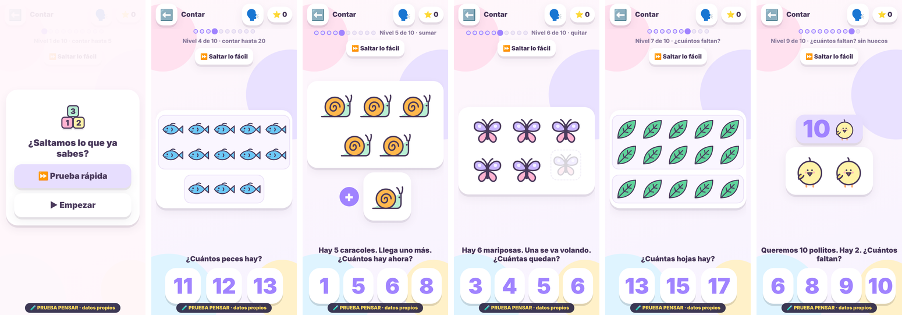
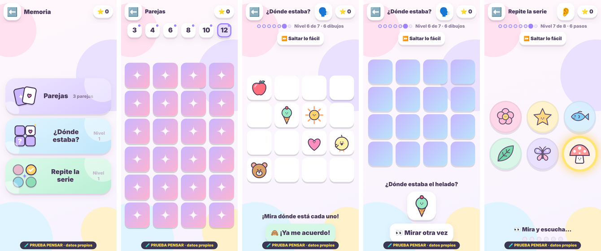
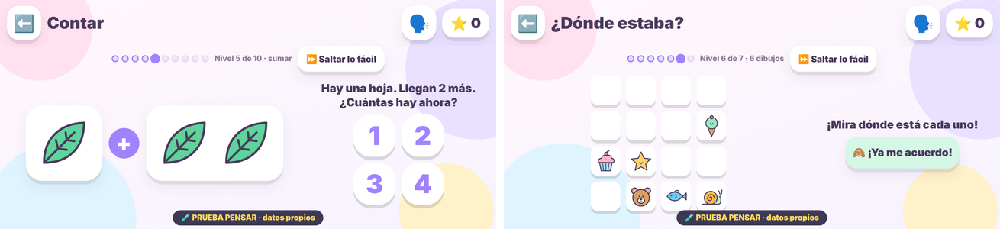
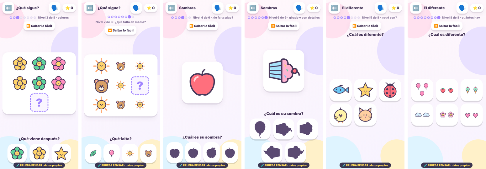
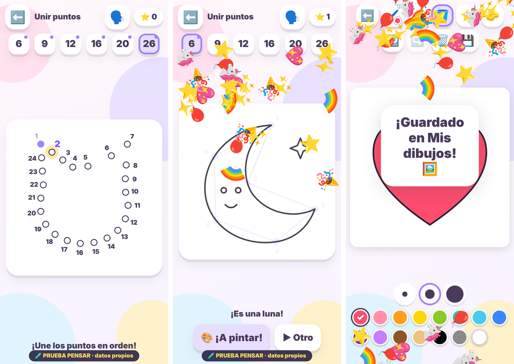
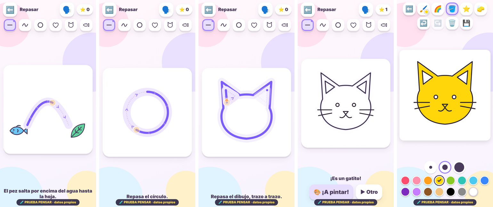

# Juegos de pensar: Contar y Memoria más retadores (04/11/2026)

**Copia aislada. No es el juego de Amaia, no está integrada y no cambia nada del juego ni de `main`.**
Rama `juegos-pensar` (creada desde `avatar-creador` `6a91012`). Datos propios con el prefijo `pen1:`.

Pedido de la propietaria (04/11/2026): «Retomamos los juegos de pensar. A Amaia le gustan todos, pero los resuelve
demasiado rápido. […] Prepara una copia aislada con mejoras en Contar y Memoria […] Muéstrame una primera versión
jugable antes de ampliar al resto. Protege las partidas y el funcionamiento sin conexión. No publiques en main todavía
ni modifiques los archivos en los que esté trabajando el otro chat.»

## Fases y estado

| Fecha | Fase | Estado |
| --- | --- | --- |
| 04/11/2026 | Primera versión jugable de Contar y Memoria en copia aislada (`5390dfc`) | Probada en Chromium (52/52). |
| 04/11/2026, 16:29 | **La propietaria aprueba en general Contar y Memoria tras probarlos en su iPhone** | Aprobación general: **no** se dan por comprobados en el iPhone todos los niveles y casos. |
| 04/11/2026 | **2.ª entrega:** «¿Qué sigue?», «Sombras» y «El diferente» con dificultad progresiva + **«Unir puntos y pintar»** (ver abajo) | Probada en Chromium (35/35 y 9/9 sin conexión); **pendiente de probar en el iPhone**. |
| 05/11/2026 | **Contar y Memoria publicados en `main`** (`021c67e`, versión `5889ab82ca5d`, D-035) | Publicado. Desde el 07/11, **solo el chat de `avatar-creador` reúne y publica**; este chat sigue en `juegos-pensar`. |
| 07/11/2026 | **3.ª entrega: «Repasar dibujos»** (menú Pintar; ver abajo) | Probada en Chromium (28/28; sin conexión 10/10); **pendiente de probar en el iPhone**. La 2.ª entrega (`cf80691`) sigue pendiente de la prueba de la propietaria. |
| 15/11/2026 | La propietaria prueba la 2.ª y la 3.ª: **se ven bien, pero son demasiado básicas; no aprobadas.** Pide, antes de ampliar el catálogo, **tres ejemplos completos y elaborados** | **4.ª entrega (ejemplos):** «Dibujos por partes» (búho, furgoneta y unicornio, para unir puntos o repasar) y el reto de Pensar «¿Quién es?» (ver abajo). Commit `5a7a226`. Probada en Chromium; **pendiente de la revisión de la propietaria**. |
| 15/11/2026, 09:42 | La propietaria: la 4.ª funciona, **pero sigue siendo fácil**; no ampliar el catálogo con la misma dificultad. Pide **tres retos avanzados distintos**, disponibles directamente | **5.ª entrega (prueba de retos avanzados):** Pensar → **Retos** (¿Quién se esconde?, La tabla de dos reglas y ¿Qué ha cambiado?; ver abajo). Commit `3e01b60`. Probada en Chromium; **pendiente de probarla con Amaia**. |
| Al integrar | Pasar Contar y Memoria al juego (`index.html`, generador de publicación, versión de `sw.js`) | Lo coordina la propietaria. |

## De dónde parte

La copia es el **juego publicado** (`main` `031ce07` = la prueba completa `4d950bc`: muñeca nueva, Pintar, Heladería,
logros, voz natural) con **tres archivos nuevos** cargados al final: `pensar.css`, `dibujos.js` y `pensar.js`.
`preparar_copia.py` reutiliza los pasos de la prueba completa y **comprueba** que el resultado es igual a ella salvo la
carpeta, el título y esos tres archivos. No cambia ningún otro archivo del repositorio.

Hoy, en el juego publicado: **Contar** pide de 1 a 10 objetos (emojis) con 3 respuestas; cada acierto da +1 ⭐ y sube
`lv_contar`, y cada fallo lo baja. **Parejas** tiene 3, 6 u 8 parejas de emojis que se eligen a mano (no se guardan).

## Qué cambia en esta copia

En el menú Pensar, «Parejas» pasa a ser **Memoria** (tres juegos) y **Contar** es nuevo. «¿Qué sigue?», «Sombras» y «El
diferente» siguen como hoy.

### Contar: 10 pasos

| Nivel | Qué se pide | Cómo se ve |
| --- | --- | --- |
| 1 | contar hasta 5 | 3 respuestas |
| 2 | contar hasta 10 | 3 respuestas |
| 3 | contar de 9 a 15 | en filas de 5 y grupos de 10 |
| 4 | contar de 12 a 20 | en filas de 5 y grupos de 10 |
| 5 | **sumar** (hasta 6): «Hay 3 fresas. Llegan 2 más. ¿Cuántas hay ahora?» | dos grupos con un «+»; 4 respuestas |
| 6 | **quitar** (hasta 6): «Hay 6 globos. 2 se van volando. ¿Cuántos quedan?» | los que se van se aclaran |
| 7 | **¿cuántos faltan?** (hasta 10): «Queremos 7 estrellas. Hay 4.» | huecos vacíos para los que faltan |
| 8 | sumar y quitar hasta 10 | |
| 9 | ¿cuántos faltan? sin huecos | el número que queremos, en grande |
| 10 | todo mezclado hasta 20 | |

- **Variedad:** 20 dibujos, colocación en filas o «suelta», respuestas cercanas (por ejemplo, 6, 7, 8 y 10, o el número de
  uno de los grupos) para que no se acierte por tamaño. Desde el nivel 3, uno de cada cuatro ejercicios aproximadamente es
  un **repaso** de un nivel anterior (no cuenta para subir ni bajar).
- Se sigue pudiendo **tocar cada dibujo para contarlo** (como hoy) y 🗣️ repite la pregunta.

### Memoria: tres juegos

- **Parejas:** de **3 a 12 parejas** (3, 4, 6, 8, 10 y 12), con botones para elegir el tamaño, como hoy. Al terminar dos
  tableros bien resueltos se pasa al siguiente tamaño.
- **¿Dónde estaba?** (recordar posiciones): se ven unos dibujos en un tablero; cuando quiere, toca **«🙈 ¡Ya me acuerdo!»**,
  se tapan y se le pregunta «¿Dónde estaba el pollito?». 7 niveles: de 2 dibujos en 2 × 2 a 8 dibujos en 4 × 4, con
  1 a 3 preguntas por ronda.
- **Repite la serie** (secuencias): unos botones con dibujos se iluminan y suenan en orden; luego los repite. 8 niveles:
  de 3 botones y 2 pasos a 6 botones y 7 pasos. 👂 la enseña otra vez.

### Reglas comunes

- **Sin cronómetro:** nada se acaba por tiempo y **la rapidez no cuenta** para nada. En «¿Dónde estaba?» los dibujos se
  ven hasta que ella decide taparlos; en «Repite la serie» la demostración va siempre al mismo ritmo.
- **Sube tras varios aciertos:** un ejercicio cuenta como bien hecho si sale a la primera o con un solo fallo, sin pista.
  Contar, «¿Dónde estaba?» y la serie suben tras **3** bien hechos seguidos en ese nivel; las parejas, tras **2** tableros.
- **Pistas cuando se atasca:**
  - Contar: al primer fallo, «¡Casi!» con una ayuda («Cuenta todos juntos», «Cuenta solo los que quedan», «Cuenta los
    huecos vacíos»…) y esa respuesta se aparta. Al segundo, se cuentan uno a uno en voz alta y brilla la buena.
  - Parejas: tras 3 fallos seguidos, asoma una pareja un momento.
  - «¿Dónde estaba?»: se ve qué había en la casilla tocada; al segundo fallo brilla la buena. «👀 Mirar otra vez» vuelve
    a enseñarlo todo.
  - Serie: al fallar se enseña otra vez; al segundo fallo brilla el siguiente botón.
- **Si se atasca 3 veces seguidas** en un nivel, sigue en el nivel anterior, sin avisos. Lo alcanzado (los puntos de
  arriba) no se pierde.
- **Sin castigos ni pérdida de premios:** los fallos no quitan estrellas ni logros.
- **Estrellas como hoy, sin premios nuevos por respuesta:**
  - Contar: +1 ⭐ por acierto, igual que ahora.
  - «¿Dónde estaba?» y la serie: +1 ⭐ por ronda completa, no por cada respuesta.
  - Parejas: 2, 3 o 5 ⭐ por tablero, como ahora.
  - Subir de nivel solo trae confeti y una frase.
- **Logros sin cambios:** `logros.js` es el mismo; responder no da logros. El reto «Contar» de «Mis logros» sigue igual.
- **Prueba rápida (⏩ «Saltar lo fácil»):**
  - La primera vez que se entra en Contar, «¿Dónde estaba?» o la serie, se ofrece «Prueba rápida» o «Empezar».
  - La prueba pone un ejercicio de cada nivel, de menos a más. Contar prueba los niveles 2, 4, 5, 6, 7 y 9; los otros
    dos juegos, unos tres niveles. Se para al primero que no sale (dos fallos) y se empieza en el último superado.
  - Solo puede **subir** el nivel, nunca bajarlo. Se puede repetir cuando se quiera con el botón.
- **El avance se guarda** y al volver se sigue donde estaba (no se empieza por lo fácil). Arriba se ve el camino de
  niveles: «Nivel 5 de 10 · sumar».
- **Dibujos propios en SVG** con el estilo de las ilustraciones de la app (trazo violeta, colores pastel, caritas), no
  emojis: manzana, fresa, estrella, flor, pez, mariposa, globo, mariquita, pollito, magdalena, corazón, nube, luna, sol,
  helado, seta, caracol, gatito, osito y hoja. Van dentro de los archivos: **no hay nada que descargar** (sirve sin
  conexión cuando se integre; la copia, como todas, no instala service worker).





## 2.ª entrega (04/11/2026): ¿Qué sigue?, Sombras, El diferente y Unir puntos

Pedido de la propietaria (04/11/2026, 16:29), resumido:
- Ampliar «¿Qué sigue?», «Sombras» y «El diferente» con dificultad progresiva: patrones más largos y que combinen forma,
  color, tamaño u orientación; siluetas parecidas con detalles que observar; diferentes con una regla que descubrir.
- Añadir «Unir puntos y pintar» (la prioridad entre los juegos nuevos): recorridos cortos primero, números claros, puntos
  separados, colorear y guardar al terminar, y contornos cerrados para el cubo.
- «Repasar dibujos» puede ir en la siguiente entrega.
- Ilustraciones cuidadas, sin emojis ni figuras provisionales.
- Que Amaia pueda jugar sin leer.
- Reutilizar el guardado y Pintar, con las mismas estrellas y logros.
- Copia aislada, partidas protegidas, funcionamiento sin conexión comprobado y nada en main.

Archivos nuevos en esta carpeta: `figuras.js` (dibujos de unir puntos), `pensar2.js` (los cuatro juegos),
`prueba-pensar2.js`, `simular_publicacion.py` y `prueba-sin-conexion.js`. Además cambian `dibujos.js` (partes
marcadas para quitarlas en sombras y diferentes; mofletes con un rosa propio para poder recolorear),
`pensar.js` (comparte sus utilidades), `pensar.css` y `preparar_copia.py`.

Las mismas reglas que Contar y Memoria:
- Sin cronómetro y sin castigos.
- Sube tras 3 aciertos limpios.
- Pistas al atascarse: primero «¡Casi! Fíjate en…» diciendo **en qué fijarse** (la forma, el color, el tamaño, hacia
  dónde mira, si le falta algo, qué son…), y después brilla la buena.
- «⏩ Saltar lo fácil», que solo sube.
- Avance guardado.
- Estrellas como hoy (+1 ⭐ por acierto) y logros sin cambios.
- Todo se dice en voz alta, y 🗣️ lo repite.

### ¿Qué sigue? (8 niveles)

| Nivel | Qué cambia |
| --- | --- |
| 1 | dos formas que se alternan |
| 2 | series de tres (AAB, ABB, ABC) |
| 3 | colores (misma forma) |
| 4 | grande y pequeño |
| 5 | hacia dónde mira (dar la vuelta o girar) |
| 6 | forma y color a la vez (4 respuestas) |
| 7 | ¿qué falta **en medio**? (dos reglas) |
| 8 | series largas con dos reglas (color y orientación o tamaño) y hueco en cualquier sitio |

- En los primeros niveles, cada fila empieza igual para que se vea la repetición.
- Las respuestas falsas solo se equivocan en una cosa (la forma, el color, el tamaño…), así que hay que fijarse en todo.
- La pista 2 colorea los grupos que se repiten.

### Sombras (6 niveles)

| Nivel | Qué cambia |
| --- | --- |
| 1 | sombras muy distintas |
| 2 | formas parecidas (redondas, alargadas, con pico…) |
| 3 | la misma figura mirando a otro lado o girada |
| 4 | la misma figura sin una parte (la manzana sin hoja, el globo sin cuerda, el pez sin aleta…) |
| 5 | todo mezclado, 5 sombras |
| 6 | el dibujo también está girado o le falta algo |

### El diferente (8 niveles)

| Nivel | Qué es distinto |
| --- | --- |
| 1 | otra forma |
| 2 | otro color |
| 3 | otro tamaño |
| 4 | mira hacia el otro lado |
| 5 | **¿qué son?**: 4 animales y una cosa de comer, del cielo…; todos con formas distintas |
| 6 | a uno le falta un detalle (la cara, los bigotes, los puntos de la mariquita…) |
| 7 | **regla con trampa**: todas las formas son distintas y lo que cuenta es el color |
| 8 | **cuántos hay**: en cada tarjeta hay los mismos dibujos, salvo en una |

### Unir puntos y pintar (menú **Pintar**, 6 niveles)

- **Niveles:** 6, 9, 12, 16, 20 y 26 puntos, con 20 dibujos: corazón, globo, hoja, luna, pez, casa, estrella, manzana,
  nube, helado, seta, barco, pollito, mariposa, gatito, osito, cohete, conejo, tortuga y ballena. Los botones de arriba
  dejan elegir el nivel, como en Parejas. Sube tras 2 dibujos.
- **Cómo se juega sin leer:** la voz dice «Une los puntos, empieza en el uno y toca el dos». El siguiente punto **brilla y
  es más grande**, y al tocarlo dice el número. Vale tocar cerca (44 px de margen) o arrastrar el dedo de punto a punto.
- **Sin castigos:** si toca lejos, no pasa nada; dice «Busca el 3, el que brilla» y, al segundo intento, aparece una línea
  guía hasta el siguiente punto.
- **Puntos separados:** siempre en las esquinas del dibujo y repartidos por igual en lo demás, a 20 px o más en
  pantalla. Si la pantalla es pequeña (iPhone en horizontal), pone algún punto menos. Los números van por fuera del
  contorno.
- **Al terminar:** aparece el dibujo completo, dice qué es («¡Es una luna!»), +1 ⭐ (como un acierto) y salen
  **«🎨 ¡A pintar!»** y «▶ Otro».
- **«¡A pintar!» abre el dibujo en Pintar**, como una lámina más: el mismo cubo, deshacer, colores y «Guardar» en «Mis
  dibujos» (sin cambiar Pintar ni su guardado). La flecha vuelve a Unir puntos. Los 20 contornos están cerrados: la
  prueba pinta dentro de cada uno y comprueba que no se sale.
- **Los dibujos:** son SVG en el mismo estilo que los 20 dibujos aprobados de Contar y Memoria (trazo, caritas,
  detalles), hechos aquí, sin emojis y sin imágenes que descargar.
  - Si prefieres ilustraciones más ricas, como las láminas de Pintar, haría falta generar por cada figura:
    1. Un **contorno exterior cerrado**, de un solo trazo negro sobre blanco, sin huecos.
    2. Una capa de **detalles interiores**: cara y líneas, también en negro.
    3. Una vista en color para la miniatura (opcional).
  - En 1000 × 1000 px, PNG con fondo transparente o blanco. A partir del contorno se colocarían los puntos solos.
  - Para esta entrega no ha hecho falta generar nada.




### Sin conexión

La copia, como todas, no instala service worker. Para comprobar el uso sin conexión antes de integrar,
`simular_publicacion.py` hace lo siguiente:
- Usa el generador de publicación de avatar-creador **sin modificarlo**: lo importa y le añade los archivos de Pensar.
- Escribe el juego publicado + Pensar en una **carpeta temporal**, fuera del repositorio.

Después `prueba-sin-conexion.js` hace este recorrido:
1. Lo sirve como GitHub Pages y lo abre con una partida.
2. Espera a que avise «Lista para jugar sin conexión».
3. Pone el **modo avión** y juega Contar, Memoria, ¿Qué sigue?, Sombras, El diferente y Unir puntos (pintar y
   guardar).

Resultado: **9/9**, sin peticiones fallidas y sin perder la partida.

## 3.ª entrega (07/11/2026): Repasar dibujos

Pedido de la propietaria (07/11/2026, 10:27), resumido:
- Seguir con «Repasar dibujos», como se acordó: líneas, curvas y formas, y después dibujos completos.
- Recorridos cómodos para el dedo, con tolerancia generosa.
- Pistas para continuar, sin reiniciar por salirse ni exigir precisión perfecta.
- Al terminar, colorear y guardar usando Pintar.
- Ilustraciones cuidadas; si hacen falta imágenes nuevas, detallarlas.
- Las mismas reglas de recompensas, partidas protegidas, y comprobar guardar, recuperar y jugar sin conexión.
- Solo la copia aislada y nada en main; dejar una nota para el chat de avatar-creador.

Archivo nuevo: **`repasar.js`**, con estilos al final de `pensar.css`. Está en el menú **Pintar → Repasar**, después
de Unir puntos.

| Nivel | Qué se repasa | Ejercicios |
| --- | --- | --- |
| 1 | líneas rectas | 4: el pollito hasta la manzana, la lluvia de la nube a la seta, el globo hasta la estrella, el gatito hasta el pez |
| 2 | curvas | 4: el salto del pez, las olas de la mariposa, las montañas, el camino de la luna |
| 3 | formas | 6: círculo → sol, cuadrado → regalo, triángulo → abeto, corazón, óvalo → huevo de colores, estrella |
| 4 | dibujos | 6: globo, hoja, luna, pez, manzana, nube |
| 5 | dibujos difíciles | 7: gatito, osito, mariposa, conejo, seta, casa, helado |
| 6 | varios trazos | 6: contorno y después aletas, puerta, orejas…, trazo a trazo |

- **Cómo se juega sin leer:**
  - La voz dice qué hacer («Lleva al pollito hasta la manzana. Pon el dedo en el punto que brilla y sigue el camino»).
  - Un punto naranja recorre el principio del camino y unas flechitas marcan la dirección.
  - El camino es una banda ancha con una línea de puntos en medio.
  - Los niveles se eligen con botones con dibujitos (línea, curva, círculo, corazón, gatito, pez), no con números ni
    letras.
- **Tolerancia generosa:** cuenta con el dedo a unos 34 px del centro del camino; las pruebas lo completan a 22 y a
  30 px. Basta llegar al 97 % del camino. El trazo morado que queda es el del camino, limpio, aunque el dedo vaya torcido.
- **Sin reiniciar ni castigar:**
  - Si se sale, el avance se queda donde estaba y el punto que brilla marca dónde seguir: «Vuelve al camino».
  - Si vuelve a salirse, dice «¡Por aquí!» y el punto naranja enseña el siguiente tramo.
  - Puede levantar el dedo y seguir cuando quiera.
  - No hay cronómetro. Solo no vale saltarse un trozo grande (no hay atajos).
- **Al terminar:**
  - Aparece el dibujo entero con su cara y sus detalles, dice qué es («¡Es un sol!»), +1 ⭐ (como un acierto) y sale
    «🎨 ¡A pintar!».
  - El dibujo se abre en **Pintar** como una lámina: el mismo cubo, colores, deshacer y «Guardar» en «Mis dibujos». La
    flecha vuelve a Repasar.
  - Los **33** dibujos tienen contornos cerrados: la prueba pinta dentro de cada uno y el cubo no se sale.
- **Niveles:** sube tras 2 dibujos sin atascarse (como Unir puntos); se puede elegir cualquier nivel con los botones. El
  avance se guarda en **`lv_repasar`** (prefijo `lv_`, ya en «Guardar / Recuperar mi progreso»). Repasar no da logros.
- **Ilustraciones:** las mismas figuras de Unir puntos (`figuras.js`) y formas propias en el mismo estilo. En los
  niveles de líneas y curvas, los dibujos de los extremos son los 20 dibujos de color ya aprobados, y al pintar salen
  con su contorno. **No ha hecho falta generar imágenes nuevas.**
  - Si más adelante se quieren dibujos más ricos para repasar, para cada uno haría falta:
    1. un **trazo de recorrido**: una línea continua de grosor uniforme, en el orden en que se dibuja, con su principio
       marcado;
    2. una capa de **detalles** que no se repasan (cara, adornos);
    3. el **contorno exterior cerrado** para el cubo.
  - Las tres capas en 1000 × 1000 px, fondo transparente.



## 4.ª entrega (15/11/2026): tres ejemplos completos para revisar

Pedido de la propietaria (15/11/2026), resumido:
- La 2.ª y la 3.ª se ven bien y se pueden pintar, pero **son demasiado básicas para Amaia**; no se aprueban todavía.
- **Unir puntos:** dibujos completos y reconocibles (animales, personajes, vehículos, pequeñas escenas), en **varios
  recorridos** que se descubren **por etapas**; niveles que lleguen a **30–60 puntos** sin amontonar números; **ayuda
  opcional** (que el siguiente no brille siempre y poder pedir pista); pintar con varias zonas cerradas y guardar.
- **Repasar:** dibujos completos con **varios trazos** (curvas, cambios de dirección, detalles interiores); **ver qué partes
  se han hecho** y **seguir sin perder trabajo**; tolerancia para el dedo (la dificultad, del recorrido); pintar y guardar.
- **Pensar:** juegos que exijan **descubrir reglas, recordar y combinar pistas**, con **niveles avanzados accesibles** sin
  repetir antes los fáciles.
- **Antes de ampliar el catálogo, tres ejemplos completos y elaborados**; nada de dibujos geométricos básicos como
  resultado final; si hacen falta ilustraciones, decir exactamente qué contornos y capas generar.
- Solo en la copia aislada, sin publicar ni cambiar las recompensas; comprobar en iPhone y sin conexión.

**Los tres ejemplos:**

| Ejemplo | Qué es | Dónde |
| --- | --- | --- |
| 1. **El búho** (animal en una pequeña escena) | El búho en su rama, de noche: cuerpo → cara → alas → rama con hoja → luna. Al final aparecen los ojos, el pico, las plumas, las patas y las estrellas. | Pintar → **Dibujos por partes** (unir puntos o repasar) |
| 2. **La furgoneta de los helados** (vehículo) | Carrocería → ruedas → ventanas (la del conductor y la de vender) → toldo ondulado → cartel del cucurucho. Al final, tapacubos, faro, puerta, rayas del toldo, mostrador, carretera. | Pintar → **Dibujos por partes** |
| 3. **El unicornio** (personaje) | Cabeza y cuello → oreja → cuerno → melena con rizos → cara (ojo y sonrisa) → estrella mágica. Al final, pestañas, moflete, espiral del cuerno y estrellas. | Pintar → **Dibujos por partes** |
| + **¿Quién es?** (reto de Pensar) | Detective: combinar pistas dibujadas para encontrar la única tarjeta que las cumple; en los niveles altos hay que recordarlas. | Pensar → **¿Quién es?** |

Archivos nuevos: **`ilustraciones.js`** (los tres dibujos), **`etapas.js`** (el juego), **`quien.js`** y
**`etapas.css`**. No cambian `pensar.css`, `dibujos.js`, `pensar.js`, `figuras.js`, `pensar2.js` ni `repasar.js`, así
que Unir puntos y Repasar de antes siguen igual (se pueden comparar).

### Dibujos por partes (menú Pintar)

- **Elegir:** tres tarjetas, cada una con dos botones dibujados: **unir puntos** o **repasar**. Hasta terminarlo, el
  dibujo sale **en misterio** (solo la silueta de la primera parte y «?»); terminado, se ve entero. Un punto naranja que
  late marca los que están **a medias**, y uno verde, los **terminados**.
- **Por etapas:** arriba, una **tira con las partes**: las hechas (con su dibujo y marca verde), la de ahora (resaltada) y
  las que faltan («?»). Cada parte hecha queda **dibujada en limpio** y aparece la siguiente con su voz («Ahora, las alas»).
  En pantalla solo están los puntos o caminos de la parte de ahora: **no se amontonan**.
- **Unir puntos:**
  - Botones **30, 45 y 60** puntos por dibujo (el total real queda cerca: 30–38, 43–47 y 45–60). La **numeración sigue**
    de una parte a otra (la cara del búho empieza en el 20…). Puntos separados **al menos 20 px** en el iPhone.
  - Los puntos se reparten según **lo largo y lo curvo** de cada trazo, y **con más peso en lo que da la forma** (el
    cuerpo, la carrocería, la cabeza); las esquinas siempre llevan punto. Los trazos muy cortos (el ojo y la sonrisa
    del unicornio) aparecen solos.
  - **Ayuda:** con 30 el siguiente brilla siempre; con 45 y 60, **no brilla** y se pide con **💡** (brilla un rato y
    traza una rayita desde el anterior). El botón del sol la enciende o apaga cuando quiera.
  - **Sin castigos:** tocar otro número dice cuál es («Ese es el 18. Busca el 2»); tras tres toques fuera, el siguiente
    se ilumina solo.
  - Al terminar con pocas ayudas, el **próximo** dibujo tendrá más puntos (nunca baja). Cambiar de puntos a medias no
    borra nada: se aplica al próximo.
- **Repasar:** los trazos de cada parte, uno tras otro (curvas, esquinas, rizos, ondas, detalles interiores), con el
  camino ancho, las flechas, el punto que brilla y la **misma tolerancia** que Repasar (unos 34 px). Salirse no borra
  nada; el trozo hecho se queda pintado.
- **Seguir donde se dejó:** el avance se guarda **al momento** (cada punto, cada trazo y al levantar el dedo), también
  al cerrar la app. Al volver: «¡Seguimos donde lo dejaste!», en la misma parte, el mismo número o el mismo sitio del
  camino.
- **Al terminar:** aparece el dibujo entero con sus detalles, lo dice («¡Es un búho en su rama, de noche!»), **+1 ⭐**
  (como un dibujo de Unir puntos o de Repasar) y «🎨 ¡A pintar!». En Pintar se colorea con el cubo (**15, 21 y 15 zonas
  cerradas**: búho, furgoneta, unicornio) y se guarda en «Mis dibujos»; la flecha vuelve a «Dibujos por partes».

### ¿Quién es? (menú Pensar, 5 niveles)

- Arriba, las **pistas dibujadas** (sin texto): **qué es** (la silueta), **de qué color** (una gota), **cuántos hay**
  (puntos), con una marca verde (sí) o roja (**no**). La voz las dice. Abajo, las tarjetas.
- **Hay que combinarlas:** solo una tarjeta las cumple todas y, por cada pista, hay una tarjeta que cumple todas las
  demás menos esa (ninguna pista sobra; comprobado con 2.000 casos).
- **Niveles:** 1) dos pistas, 6 tarjetas; 2) tres pistas, 9 tarjetas; 3) una pista de «no»; 4) **pistas escondidas**:
  primero se miran, se toca la lupa y se tapan (hay que recordarlas); 5) **el gran reto**: dos pistas de «no», cuántos
  hay, 12 tarjetas y pistas escondidas.
- **Los cinco niveles se eligen directamente** con sus botones (sin repetir antes los fáciles); también sube solo tras
  dos aciertos limpios. Sin reloj: las pistas se tapan cuando ella toca la lupa.
- **Sin castigos:** una tarjeta equivocada se aparta, se ilumina la pista que no cumple y la dice («Esa no. Mira esta
  pista: no es de color rojo»). **💡** vuelve a enseñar las pistas un rato. +1 ⭐ por acierto, como los demás juegos.

### Ilustraciones: no ha hecho falta generar imágenes

Los tres dibujos están hechos a mano como trazos (SVG en `ilustraciones.js`): funcionan sin conexión, se escalan sin
perder calidad y cada trazo sirve a la vez para los puntos, para repasar y para el cubo de Pintar. Si para ampliar el
catálogo se prefiere generarlos aquí, **cada dibujo necesita estas capas**, en 1000 × 1000 px, fondo transparente, trazo
negro uniforme de 10 px, sin rellenos, sombras ni texturas:
1. **Una capa por parte** (de 4 a 6, en el orden en que se descubren), cada una con sus **trazos sueltos**: contornos
   **cerrados** para lo que se pinta (cuerpo, ala, rueda…) y trazos **abiertos** para rizos, ramas o sonrisas. Cada trazo,
   de un solo gesto continuo y sin cruzarse consigo mismo.
2. **Una capa de detalles** (ojos, rayas, estrellas…) que no se repasan pero cierran zonas para pintar.
3. Todas juntas deben dejar **al menos 12 zonas cerradas**; entre líneas paralelas, **al menos 60 px** de separación
   (para que los puntos no se amontonen).
4. Lo ideal es entregarlas como **trazados vectoriales (SVG)**, una capa por parte; una imagen en píxeles habría que
   convertirla a trazos.

## 5.ª entrega (15/11/2026): prueba de retos avanzados

Pedido de la propietaria (15/11/2026, 09:42), resumido:
- La 4.ª funciona, pero **sigue siendo fácil para Amaia**: no ampliar el catálogo con ejercicios de la misma dificultad.
- **Niveles avanzados disponibles directamente.** ¿Quién es? con 8–12 candidatos y 3–4 pistas que haya que combinar
  (negaciones, cantidades y relaciones), sin que una sola pista dé la respuesta, y una modalidad en la que **ella elija qué
  preguntar**. Patrones: dos reglas a la vez, huecos interiores, ordenar piezas. Memoria: qué cambió en una escena,
  reconstruir posiciones, secuencias al revés. Contar: problemas de dos pasos, repartir y cuánto falta.
- En Unir puntos y Repasar, dibujos más ricos, sin confundir más puntos o trazos diminutos con más dificultad.
- Pistas voluntarias, sin cronómetro ni castigos; **elegir el reto y recordar dónde estaba**.
- **Primero, tres retos avanzados distintos** para probarlos con ella: que tenga que **pensar, elegir una estrategia y
  revisar su respuesta**. Solo en la copia aislada, sin publicar ni cambiar recompensas.

Archivos nuevos: **`retos.js`** y **`retos.css`**. No cambia ningún archivo de las entregas anteriores. En el menú
**Pensar → Retos**: una lista con los tres retos y los botones de sus niveles (1, 2, 3…), para entrar directamente en el
que se quiera. Recuerda el último reto (resaltado) y el nivel de cada uno.

**Lo común a los tres:**
- **Revisar antes de dar por buena la respuesta:** se elige y luego se confirma (lupa) o se **comprueba** (botón verde).
  Al comprobar, lo que está bien **se queda** y solo vuelve lo que no va, con la explicación.
- **Sin castigos:** un error no quita nada; dice por qué no vale y deja seguir.
- **Pistas voluntarias (💡), cada vez más concretas**; nunca salen solas.
- **Sin cronómetro:** las escenas y las pistas se miran el tiempo que quiera; se tapan cuando ella toca el ojo.
- +1 ⭐ por reto resuelto (como un acierto en los demás juegos); sin logros nuevos.

### 1. ¿Quién se esconde? — combinar pistas y elegir buenas preguntas

| Nivel | Qué es | Habilidad | Por qué es más difícil que ¿Quién es? |
| --- | --- | --- | --- |
| 1 | 8 sospechosos, 3 pistas: una de **«no es…»**, un color y una **cantidad comparada** («hay más de uno», «hay menos de tres») | Combinar condiciones, incluida una negación y una comparación | Antes eran 2 pistas iguales que el dibujo; ahora hay que traducir «no» y «más de / menos de» |
| 2 | 12 sospechosos, 4 pistas: dos de «no», una cantidad y una **relación de posición** («a su lado hay un pez», «justo encima tiene una estrella») | Razonar sobre el tablero, no solo sobre cada tarjeta | La relación obliga a mirar a los vecinos de cada sospechoso |
| 3 | **Tú preguntas:** 12 sospechosos y 11 preguntas dibujadas (qué es, qué color, más de 1 o de 2, qué tiene al lado); cada respuesta (sí/no) queda arriba como pista | **Estrategia**: elegir preguntas que descarten muchos, y tachar | Ella decide qué información pedir; al acabar le dice cuántas preguntas ha usado |

- **Ninguna pista sola deja menos de 3 sospechosos** y **todas hacen falta** (por cada pista hay alguien que cumple las
  demás menos esa). Comprobado con 1.000 casos.
- **Tachar es su herramienta:** toca una tarjeta y la tacha (o la destacha) para pensar; con la lupa dice «¡es este!».
- **Si se equivoca:** «Ese no puede ser. Mira esta pista…», se ilumina la pista que no cumple y se tacha.
- **💡:** primero señala la pista que más descarta; si la pide otra vez, tacha los que no la cumplen. Si aún no ha
  preguntado nada, le propone una buena pregunta.

### 2. La tabla de dos reglas — descubrir reglas, huecos interiores y ordenar

| Nivel | Qué es | Habilidad | Dificultad |
| --- | --- | --- | --- |
| 1 | Tabla 3 × 3: en cada fila, la misma cosa; en cada columna, el mismo color. 3 huecos (siempre el del centro) | Ver dos reglas a la vez (filas y columnas) | La bandeja trae piezas trampa que aciertan una regla y fallan la otra |
| 2 | Filas: la misma cosa; columnas: **la misma cantidad**. 4 huecos | Cruzar «qué es» con «cuántos» | Más huecos y trampas con la cantidad equivocada |
| 3 | **Cuadrado mágico:** en cada fila y columna está cada cosa **una sola vez**, y cada fila tiene su color. 4 huecos | Deducir por eliminación | Ninguna fila sola basta; se comprueba que **solo hay una manera** de llenarlo |
| 4 | **Ordenar el final de la fila:** las cosas se repiten de 3 en 3 y los colores de 2 en 2; colocar las 3 últimas entre 6 piezas | Dos patrones con distinto ritmo y orden | Hay que seguir los dos ritmos a la vez para cada pieza |

- Se toca una pieza y luego su hueco (se puede quitar y cambiar). **Comprobar** solo cuando están todos llenos.
- **Al comprobar:** las buenas se quedan; las otras vuelven a la bandeja y se iluminan la fila y la columna de una, con sus
  reglas en voz alta.
- **💡 en tres pasos:** la regla de la fila, después también la de la columna y, si la vuelve a pedir, coloca esa pieza.

### 3. ¿Qué ha cambiado? — memoria de escena

| Nivel | Qué es | Habilidad | Dificultad |
| --- | --- | --- | --- |
| 1 | Estantería 3 × 3 con 6 cosas; se tapa y **una ha cambiado** (se ha movido, ha desaparecido, ha aparecido otra o ha cambiado de color). Tocar dónde | Recordar qué había y dónde | Hay que guardar a la vez qué cosas y sus sitios |
| 2 | 4 × 3 con 7 cosas y **dos cambios** (también de color). Marcar dos y comprobar | Memoria más cargada y revisar | Al comprobar, el que está bien se queda y le dice que falta otro |
| 3 | **Colocar de memoria:** 5 cosas; se vacía la estantería y hay que ponerlas donde estaban | Reconstruir posiciones | Planificar el orden y revisar al comprobar |
| 4 | **Al revés:** 4 cosas brillan una tras otra; tocarlas en el **orden inverso** | Memoria de trabajo: guardar y dar la vuelta | Un toque fuera de orden no borra lo hecho |

- **Se mira sin reloj** hasta tocar el ojo; entonces se cierran las casillas un momento y se abren con la escena nueva.
- **💡 vuelve a enseñar cómo estaba** (fondo azul) las veces que quiera, y otra vez para volver; en «al revés», repite el
  orden.
- Cuando se equivoca: «Ahí no ha cambiado nada», «Una está bien: falta otra», «Dos no estaban ahí; las he devuelto»,
  «Ese brilló, pero no toca ahora».

### Qué queda para después de probarlos

- **Contar** (dos pasos, repartir, cuánto falta, con objetos de apoyo opcionales): pedido, aún no hecho; irá en la
  siguiente tanda, según lo que se vea con estos tres.
- **Dibujos más ricos** en Unir puntos y Repasar: la dificultad vendría de recorridos más largos y con más partes, no de
  más puntos o trazos diminutos; también después.
- Las preguntas de «a su lado» en «Tú preguntas» se dibujan pequeñas en el iPhone en horizontal; si cuesta verlas, se
  agrandan.

## Datos

- Todo va con el prefijo `pen1:` (`aislamiento.js`); sin service worker; manifiesto propio («PRUEBA PENSAR»).
- **Claves nuevas**, todas con el prefijo `lv_`, que «Guardar / Recuperar mi progreso» ya incluye sin cambiar
  `progreso.js`: `lv_contar2`, `lv_parejas`, `lv_donde` y `lv_serie`, con la forma `{v:1, L, max, ok, apuros, prueba}`.
  Si alguna vez llegan con valores raros, se corrigen al leerlas.
- La clave antigua **`lv_contar` no se cambia ni se borra**: solo se lee la primera vez. Quien ya contaba hasta 9 o 10 en
  el juego (`lv_contar` ≥ 6) empieza en el nivel 2.
- 2.ª entrega: `lv_sigue2`, `lv_sombras2`, `lv_distinto2` y `lv_puntos`, con la misma forma. Las antiguas `lv_sigue`,
  `lv_sombras` y `lv_distinto` solo se leen: quien iba por 6 o más empieza en el nivel 2. Los dibujos de Unir puntos se
  guardan en «Mis dibujos» (`gal`), como cualquier dibujo de Pintar.
- 3.ª entrega: `lv_repasar`, con la misma forma. Los dibujos pintados van a «Mis dibujos» (`gal`).
- 4.ª entrega: **`lv_etapas`** (Dibujos por partes: `{v:1, nivel, ayuda, hechos:{"buho:pu":1…}, curso:{"buho:pu":{e, j, i,
  pts}…, "furgoneta:rp":{e, j, prog}}}`; lo «a medias» incluye los puntos, para seguir igual) y **`lv_quien`** (con la
  forma de los demás niveles). Si llegan con valores raros, se ignoran y se empieza de nuevo. Los dibujos pintados van a
  «Mis dibujos» (`gal`).
- 5.ª entrega: **`lv_retos`** (`{v:1, ultimo, L:{detective, tabla, escena}, hechos:{…}}`: el último reto, el nivel elegido en
  cada uno y cuántos ha resuelto). Si llega con valores raros, se corrigen al leerla.
- Ninguna otra clave cambia: estrellas (solo suman), dibujos, Heladería, personaje, escenas, logros, voz y sonido.

## Pruebas (Chromium; iPhone e iPad simulados, app instalada y hoja de compartir simuladas)

```bash
python3 -m http.server 8765 &
python3 docs/propuestas/pensar-2026-11-04/preparar_copia.py      # regenera index.html, progreso.js y logros.js
node docs/propuestas/pensar-2026-11-04/prueba-pensar.js          # 52 comprobaciones (Contar y Memoria)
node docs/propuestas/pensar-2026-11-04/prueba-pensar2.js         # 35 comprobaciones (2.ª entrega)
node docs/propuestas/pensar-2026-11-04/prueba-repasar.js        # 28 comprobaciones (3.ª entrega)
node docs/propuestas/pensar-2026-11-04/prueba-etapas.js         # 39 comprobaciones (4.ª entrega: Dibujos por partes)
node docs/propuestas/pensar-2026-11-04/prueba-quien.js          # 22 comprobaciones (4.ª entrega: ¿Quién es?)
node docs/propuestas/pensar-2026-11-04/prueba-retos.js          # 62 comprobaciones (5.ª entrega: Retos)
node docs/propuestas/pensar-2026-11-04/prueba-sin-conexion.js    # 13 comprobaciones (modo avión, simulación de publicación)
```

**5.ª entrega (15/11/2026): `prueba-retos.js` 62/62 y `prueba-sin-conexion.js` 13/13.** Comprueban:
- **Lista de retos:** niveles a la vista, entrar directamente en uno avanzado, recordar el último reto y su nivel.
- **¿Quién se esconde?:**
  - 1.000 casos, con una sola respuesta, ninguna pista que sola deje menos de 3 y todas necesarias.
  - Pistas de negación, cantidad y relación.
  - Tachar y destachar; un error sin castigo, con su explicación.
  - 💡 en dos pasos, que nunca tacha al escondido.
  - +1 ⭐, sin logros.
  - «Tú preguntas», resuelto con 4 preguntas: respuestas coherentes con el escondido y su número dicho al final.
- **La tabla:**
  - 800 tablas, con el centro siempre vacío, la bandeja con lo que falta y trampas, y el cuadrado mágico con una sola solución.
  - Comprobar devuelve solo la pieza equivocada y explica las dos reglas.
  - 💡 en tres pasos; +1 ⭐; la fila para ordenar.
- **¿Qué ha cambiado?:**
  - 800 escenas con justo los cambios que tocan.
  - Mirar sin reloj; tocar donde no cambió nada; 💡 para volver a mirar.
  - Uno y dos cambios; colocar de memoria con dos cambiadas de sitio; al revés con un toque fuera de orden.
- **Datos:** `lv_retos` guardado y en la copia de seguridad; datos estropeados.
- **Pantallas:** iPhone e iPad, vertical y horizontal, en seis pantallas de los retos.
- **Sin conexión:** los tres retos resueltos en modo avión.

**4.ª entrega (15/11/2026): `prueba-etapas.js` 39/39, `prueba-quien.js` 22/22, `prueba-sin-conexion.js` 12/12.** Comprueban:
- **Dibujos por partes:** menú, tarjetas en misterio, puntos solo de la parte de ahora (45 → 46 puntos, separados 28 px en el
  iPhone), ayuda a petición y 💡, «Ese es el N» sin castigo, iluminar tras tres toques fuera, numeración seguida entre
  partes, tira de partes, cerrar y volver (mismos puntos y mismo número), cambiar de puntos a medias sin borrar nada,
  final con todos los detalles, +1 ⭐ sin logros, subir el próximo a 60, Pintar con el cubo y guardar, **15, 21 y 15
  zonas cerradas**, Repasar con el dedo a 28 px, salirse sin perder nada, seguir a medio trazo tras cerrar la app, partes
  con varios trazos, los 6 recorridos completos (3 dibujos × 2 maneras), copia de seguridad (también lo que está a
  medias) y recuperarla dos veces, datos estropeados sin errores, y las cuatro pantallas.
- **¿Quién es?:** 2.000 casos con solución única y sin pistas que sobren, pistas sin texto ni emojis, tarjeta equivocada
  sin castigo, +1 ⭐, subir con dos aciertos limpios, el gran reto elegido directamente, pistas escondidas y 💡, su nivel
  guardado y en la copia de seguridad, y las cuatro pantallas en los niveles 2 y 5.
- **Sin conexión:** además de lo anterior, el búho por partes con pintar y guardar, y ¿Quién es? con pistas escondidas.
- Las pruebas anteriores siguen correctas (52/52, 35/35, 28/28), con la comprobación de los menús ampliada a los botones
  nuevos; `pruebas/prueba-juego.js` 21/21 y `pruebas/prueba-copia.js` 45/45.

**3.ª entrega (07/11/2026): `prueba-repasar.js` 28/28.** Comprueba:
- **Menú y voz:** el menú Pintar, que lo explique en voz alta y la demostración.
- **Niveles:** seis botones dibujados, sin emojis.
- **Recorridos:** los 33 se completan con el dedo desviado y dan +1 ⭐ cada uno.
- **Precisión:** con el dedo a 75 px no avanza; no hay atajos; a 30 px sí avanza.
- **Salirse:** no reinicia; salen las dos pistas y se puede seguir tras levantar el dedo.
- **Varios trazos:** al terminar uno se enciende el siguiente.
- **Avance:** sube de nivel, se guarda y se recuerda; no da logros.
- **Pintar:** el cubo y «Guardar»; la flecha vuelve a Repasar.
- **Contornos:** los 33 están cerrados.
- **Copia de seguridad:** «Guardar» y «Recuperar mi progreso»; recuperar dos veces no cambia nada.
- **Pantallas:** iPhone e iPad, vertical y horizontal.
- **Sin errores de JavaScript.**

Además: `prueba-sin-conexion.js` **10/10** (en modo avión también Repasar, pintar y guardar), `prueba-pensar.js` 52/52,
`prueba-pensar2.js` 35/35, `pruebas/prueba-juego.js` 21/21 y `pruebas/prueba-copia.js` 45/45. **Sin probar en el
iPhone ni en el iPad reales.**

**2.ª entrega (04/11/2026): 35/35 y 9/9; la de Contar y Memoria sigue en 52/52.** `prueba-pensar2.js` comprueba:
- **Menús:** los de Pensar y Pintar.
- **Datos:** las claves antiguas solo se leen y los demás datos no cambian.
- **Ejercicios:** 4500 generados, siempre con una sola respuesta buena, opciones distintas, sin emojis y con
  variedad. Las reglas de cada nivel son las previstas.
- **Juego:** subir de nivel, las dos pistas, sin cronómetro, prueba rápida y avance guardado. Responder no da logros y
  la copia de seguridad incluye las claves nuevas.
- **Unir puntos:** voz y punto que brilla; tocar lejos no castiga y saca la guía; se puede arrastrar el dedo.
  - Al terminar: dibujo, +1 ⭐, Pintar con el cubo, guardar y volver.
  - Los **20 contornos están cerrados** (el cubo no se sale).
  - Los puntos están separados y los números se leen en el iPhone.
- **Pantallas:** las de los cuatro juegos, en iPhone e iPad, vertical y horizontal.
- **Sin errores de JavaScript.**

Resultado 04/11/2026: **52/52**. Comprueba:
- **La copia:** es la prueba completa más tres archivos; fuera de su carpeta no cambia nada.
- **Datos:** datos propios; los que ya había no cambian y el juego y las otras copias quedan intactos.
- **Contar:** 3000 ejercicios generados, con la respuesta igual a lo que se ve, opciones sin repetir y frases bien
  escritas. Sube tras 3 aciertos, sin cronómetro, con las dos pistas, retrocede tras 3 atascos sin perder lo alcanzado y
  recuerda el nivel al volver. La prueba rápida sube de nivel y nunca baja.
- **Memoria:**
  - Parejas: de 3 a 12, sube de tamaño y da la pista.
  - «¿Dónde estaba?»: no se tapa sola, da +1 ⭐ por ronda, sube de nivel, da la pista y deja mirar otra vez.
  - Serie: demostración, +1 ⭐ por serie, sube de nivel, pistas y prueba rápida.
  - Los tres recuerdan el nivel al volver.
- **Copia de seguridad:** guarda y recupera el avance nuevo; importarla dos veces no cambia nada.
- **El resto, como hoy:** «¿Qué sigue?», «Sombras» y «El diferente» funcionan; el reto de logros no cambia y Contar no
  da logros.
- **Sin emojis ni descargas externas.**
- **Pantallas:** todo a la vista en iPhone e iPad, vertical y horizontal, con botones de 44 px o más y sin solaparse.
- **Sin errores de JavaScript.**

Además, sin cambios y correctas: `pruebas/prueba-juego.js` 21/21, `pruebas/prueba-copia.js` 45/45 y la prueba
completa (`prueba-completa.js`) 23/23 + 37/37.

**No probado:** en un iPhone o iPad reales, con la app instalada, ni sin conexión. La voz real del iPhone tampoco (en
Chromium está simulada).

## Cómo probarla en el iPhone

1. Abrir el enlace fijo en Safari (abajo) y, si se quiere, «Compartir → Añadir a pantalla de inicio» (sale como
   «PRUEBA PENSAR»). Tiene sus propios datos, separados de los de Amaia.
2. **Pensar → Contar** → «Prueba rápida» (o «Empezar»). Probar a fallar dos veces para ver la pista.
3. **Pensar → Memoria** → Parejas (elegir 10 o 12), «¿Dónde estaba?» y «Repite la serie».
4. Salir y volver a entrar: cada juego debe seguir en su nivel.

Enlace fijo de la 1.ª entrega (commit `5390dfc`): <https://raw.githack.com/LaPiazzaAndorra/mis-juegos/5390dfc72baa906c6dacd8a147432bd473e20df5/docs/propuestas/pensar-2026-11-04/index.html>

**2.ª entrega** (los datos de la 1.ª siguen, porque usan las mismas claves `pen1:`):
1. **Pensar → ¿Qué sigue?** → «⏩ Prueba rápida». Fallar una vez para oír «Fíjate en…» y otra para ver la que brilla.
2. **Pensar → Sombras** y **El diferente**: probar «Saltar lo fácil» y fallar a propósito para ver las pistas.
3. **Pintar → Unir puntos**: unir un dibujo (tocando o arrastrando el dedo), «🎨 ¡A pintar!», pintar con el cubo,
   guardar y volver con la flecha. Probar el botón «26».
4. Salir y volver a entrar: cada juego sigue en su nivel.

Enlace fijo de la 2.ª entrega (commit `cf80691`): <https://raw.githack.com/LaPiazzaAndorra/mis-juegos/cf8069124cc85e54a12927aed0c5a9a6d16a0ffa/docs/propuestas/pensar-2026-11-04/index.html>

**3.ª entrega** (Repasar; incluye también la 2.ª):
1. **Pintar → Repasar.** Escuchar la instrucción y seguir el camino con el dedo, también algo torcido.
2. Salirse a propósito: el avance no se pierde y el punto que brilla marca dónde seguir.
3. Terminar un dibujo → «🎨 ¡A pintar!» → pintar con el cubo → Guardar → volver con la flecha.
4. Probar los botones de nivel (círculo, gatito, pez = varios trazos).
5. Salir y volver a entrar: sigue en su nivel.

Enlace fijo de la 3.ª entrega (commit `9ca48f1`): <https://raw.githack.com/LaPiazzaAndorra/mis-juegos/9ca48f1f5194320b73131de8848704378dffd551/docs/propuestas/pensar-2026-11-04/index.html>

**5.ª entrega (prueba de retos avanzados; incluye todo lo anterior):** **Pensar → Retos**.
1. **¿Quién se esconde?** → botón **2**: escuchar las pistas, tachar los que no pueden ser y elegir con la lupa.
   Equivocarse a propósito para oír por qué. Luego el **3** (tú preguntas): ¿con cuántas preguntas lo encuentra?
2. **La tabla de dos reglas** → botones **1** y **3** (el cuadrado mágico); probar el **4** (ordenar la fila). Poner alguna
   pieza mal y comprobar.
3. **¿Qué ha cambiado?** → **1** y **2**; luego **3** (colocar de memoria) y **4** (al revés). Probar la bombilla para volver
   a mirar.
4. Salir y volver a **Retos**: el último queda resaltado y cada uno en su nivel.

Enlace fijo de la 5.ª entrega (commit `3e01b60`): <https://raw.githack.com/LaPiazzaAndorra/mis-juegos/3e01b607d6d6c4e46075e409ee9bfc2cc52b92a2/docs/propuestas/pensar-2026-11-04/index.html>

**4.ª entrega (ejemplos para revisar; incluye todo lo anterior):**
1. **Pintar → Dibujos por partes.** Elegir una tarjeta y los **puntos**. Unir la primera parte: ver cómo queda dibujada y
   salen los puntos de la siguiente, con la tira de arriba marcándola.
2. Probar **45** o **60**: el siguiente no brilla; tocar **💡** para la pista y tocar un número equivocado para oír cuál es.
3. **Salir a medias** (incluso cerrar la app) y volver: debe seguir en el mismo número.
4. Terminar → «🎨 ¡A pintar!» → pintar varias zonas con el cubo → Guardar → flecha.
5. La misma tarjeta con el **lápiz** (repasar): las partes con varios trazos, salirse a propósito y seguir.
6. **Pensar → ¿Quién es?**: probar el nivel 1 y, directamente, el de la **estrella** (gran reto): mirar las pistas,
   tocar la lupa, buscar; tocar **💡** si no se acuerda.

Enlace fijo de la 4.ª entrega (commit `5a7a226`): <https://raw.githack.com/LaPiazzaAndorra/mis-juegos/5a7a226466e34e538399976a259a52638d7ccd2f/docs/propuestas/pensar-2026-11-04/index.html>

## Pendiente (decide la propietaria)

- **5.ª entrega:** probar los tres retos con Amaia y decidir el siguiente paso (Contar avanzado, más retos y dibujos más ricos).
- **4.ª entrega:** revisar los tres ejemplos y ¿Quién es?. Si la dirección es buena, ampliar el catálogo con más dibujos
  por partes (otros animales, personajes, vehículos y escenas) y llevar la misma idea (descubrir reglas, recordar y
  combinar) a más juegos de Pensar. Decidir también si «Dibujos por partes» **sustituye** a Unir puntos y Repasar de
  antes o se queda junto a ellos.

- **Integración:** la hace el chat de `avatar-creador` cuando apruebes cada entrega; los commits y archivos exactos están en [`INTEGRAR.md`](INTEGRAR.md).

- **Coordinación con avatar-creador (Mi Mundo):** el otro chat ha ampliado el generador de publicación con
  `--con-mimundo` (`b6f2515`). Lo de Pensar se añadiría en el mismo punto de la página (antes de `offline-lista.js`) y en
  la misma lista para jugar sin conexión, sin tocar sus archivos. Al integrar habrá que juntar las dos cosas en ese
  generador (lo coordina la propietaria).

- La valoración en el iPhone con Amaia: si los saltos de nivel y las pistas van bien, o hay que ajustar cuántos aciertos
  hacen falta para subir (3, o 2 en las parejas).
- Si se mantiene +1 ⭐ por acierto en Contar, como hoy.
- «Repasar dibujos» (siguiente entrega).
- Si se quieren ilustraciones más ricas para Unir puntos (lo que habría que generar está en la 2.ª entrega).
- La integración en el juego, que coordina la propietaria. Habría que cambiar `index.html` con estos tres archivos, el
  generador de publicación (que está en la rama del otro chat) y la versión de `sw.js` para la caché sin conexión.
  `ESTADO_ACTUAL.md`, `REGISTRO_CAMBIOS.md`, `MANUAL_PROYECTO.md` y `HOJA_DE_RUTA.md` son documentos compartidos con el
  otro chat: esta fase queda documentada aquí y se pasará a ellos al integrar.
