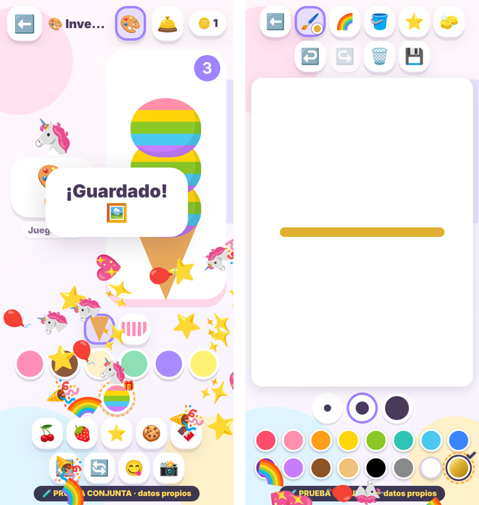

# Prueba conjunta: Pintar + Heladería + logros (22/10/2026)

**Copia aislada. No es el juego de Amaia, no está integrada y no cambia nada del juego.** Sirve para probar juntas, en una
sola versión, las dos referencias aprobadas y la primera prueba de logros, antes de decidir nada sobre la integración.

Rama `pintar-heladeria`. Datos propios con el prefijo `con1:` (no lee ni escribe los del juego ni los de las otras copias).

## Qué junta

| Parte | De dónde sale | Estado |
| --- | --- | --- |
| Pintar | referencia `708c2f2` (`../pintar-2026-10-21/`) | Código **idéntico** (la prueba lo compara carácter a carácter). |
| Heladería | referencia `7aeb5b7` (`../heladeria-2026-10-21/`) | Código idéntico salvo los dos ajustes 2 y 4 de abajo. |
| Logros | primera prueba `192e9b9` (`../logros-prueba-2026-10-21/`) | Mismas reglas: Contar y Colores (3 rondas), 1 logro por reto y día, tareas confirmadas con código, cofres a los 3, 6 y 10, premios provisionales 🎁. |

`preparar_copia.py` **no copia a mano**: lee los generadores de las tres carpetas y vuelve a aplicar exactamente sus
sustituciones sobre el `index.html` del juego. Las carpetas de referencia no se han tocado.

## Ajustes propios de esta copia (los únicos)

1. «Mis dibujos» seguro (no borra los antiguos al llenarse): lo traen Pintar y la Heladería; se aplica una vez.
2. **Pedidos de la Heladería nueva:** solo piden los 6 sabores y 5 adornos de siempre, nunca un premio.
3. `logros.js` adaptado a la Pintar y la Heladería nuevas (el color dorado entra en la paleta de 16; el sabor arcoíris
   respeta las 4 bolas, «quitar la última» y la foto). `progreso.js` de esta carpeta: el del juego con `logros`, `tareas`
   y `premios` añadidos a la lista de claves; **recuperar funciona como hoy** (la unión de historiales sigue pendiente).
4. Foto de la Heladería: el sabor arcoíris se fotografía con un color liso.
5. **Voz con tono natural siempre** (tono 1,00, velocidad 0,95), sin voces agudas. En Ajustes solo queda «🙂 Natural»
   (tocarlo dice una frase). El botón **🔊/🔇** de inicio la silencia como siempre. La clave guardada `tone` **no se cambia
   ni se borra**: se ignora. Las referencias congeladas conservan su voz anterior (no se tocan).

## Datos

- Todo va con el prefijo `con1:` (`aislamiento.js`); sin service worker; manifiesto propio («PRUEBA CONJUNTA»).
- Comprobado con datos parecidos a los de una partida (⭐ 37, 2 dibujos, monedas, pedidos servidos, nivel de la Heladería,
  niveles de Pensar, voz, tono, personaje, escenas): **se leen, no se pierden y al jugar solo suman lo que toca**; los
  datos del juego y de las copias `pin1:`, `hel1:`, `rec1:` quedan intactos.
- «Guardar mi progreso» incluye dibujos, estrellas, Heladería (con su nivel), logros, tareas y premios. Importar la misma
  copia dos veces no duplica nada.

## Pruebas (Chromium; iPhone e iPad simulados, app instalada y hoja de compartir simuladas)

```bash
python3 -m http.server 8765 &
python3 docs/propuestas/prueba-conjunta-2026-10-22/preparar_copia.py      # regenera index.html y progreso.js
node docs/propuestas/prueba-conjunta-2026-10-22/prueba-conjunta.js        # 37 comprobaciones
```

Resultado 22/10/2026: **37/37**. Además, sin cambios y otra vez correctas: Pintar 188/188, Heladería 47/47,
progreso de la Heladería 19/19, logros 37/37, juego 21/21 y copia de seguridad 45/45.

**Comprobado por la propietaria en su iPhone (22/10/2026, 08:47):** todas las páginas se abren bien. Es lo único
confirmado en el iPhone; el resto del recorrido (pintar, pedidos, retos, tareas, cofres, premios, voz, copia de seguridad)
no se da por comprobado allí.
Se ve la **muñeca antigua**, como estaba previsto: esta copia sale de la rama `pintar-heladeria` y no incluye el trabajo
del avatar. Cuando terminen las variantes del hada se preparará otra copia que reúna los dos trabajos (la coordina la
propietaria). Esta prueba y sus datos (`con1:`) se conservan.

**No probado:** en un iPad real, con la app instalada, ni sin conexión. Las voces reales del iPhone tampoco
(en Chromium la voz está simulada: se comprueban el tono, la velocidad y el silencio).



## Cómo probarla en el iPhone

Abrir el enlace fijo (abajo) en Safari, «Compartir → Añadir a pantalla de inicio» (sale como «PRUEBA CONJUNTA»), y
recorrer: pintar y guardar; abrir una lámina nueva; servir pedidos y jugar libre; en 🏅 «Mis logros», hacer los retos
Contar y Colores, marcar una tarea y confirmarla en 👪 «Adultos» (la primera vez se elige un código de 4 cifras y se repite; es propio de esta copia), abrir el cofre y elegir un
premio; comprobar que aparece en la Pintar o la Heladería; escuchar la voz y silenciarla con 🔇.

Enlace fijo (commit `461c4f2`): <https://raw.githack.com/LaPiazzaAndorra/mis-juegos/461c4f245f15c0942ecd7f93f825d9a92771f42c/docs/propuestas/prueba-conjunta-2026-10-22/index.html>

## Pendiente (decide la propietaria)

Umbrales y premios definitivos; unión de historiales en `progreso.js`; integración en el juego (coordinada por la propietaria).
